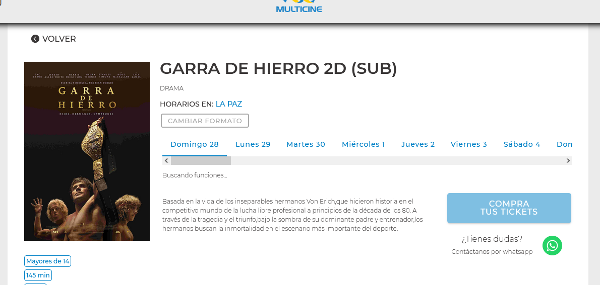
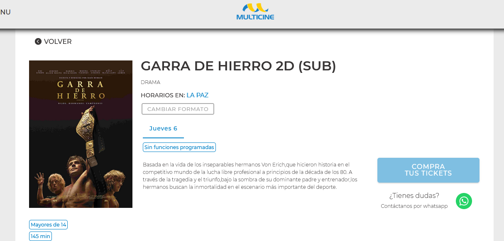

# Bug report template

## #BUG-01-F · Bug Report

| Campo | Detalle |
|---|---|
| **Title** | Error al seleccionar horario durante la compra de boletos |
| **Descripción** | Durante el proceso de compra de boletos en el sitio <https://www.multicine.com.bo/movie/4146>, al intentar seleccionar los horarios para una función específica, se produce un error que impide completar la selección y avanzar en el proceso de compra. |
| **Pasos** | 1.- Ingresar al sitio web <http://www.multiicine.com.bo> 2.- Seleccionar botón "comprar entrada aquí" 3.- Seleccionar día de la película **Referencia:** TC-05-F |
| **RESULTADO ACTUAL** | Se observa error al seleccionar horario para comprar las entradas; sale mensaje "Sin función programada". |
| **RESULTADO ESPERADO** | Se espera que al seleccionar un horario disponible, este marque como seleccionado y permita continuar con el proceso de compra. |
| **PRIORIDAD** | Alta (escala 1-5) → **1** |
| **SEVERIDAD** | Crítica (escala 1-5) → **1** |
| **AMBIENTE** | Dispositivo = PC/LAPTOP Sistema operativo = Windows 10 Navegador = Firefox Versión del software = No aplica |
| **ADJUNTOS** | Ver capturas abajo |
| **COMENTARIOS** | El bug es muy intuitivo. Este problema afecta directamente la capacidad de los usuarios para completar la compra de boletos en el sitio web, lo que puede resultar en pérdidas de ventas y una mala experiencia de usuario. |

### Adjuntos

